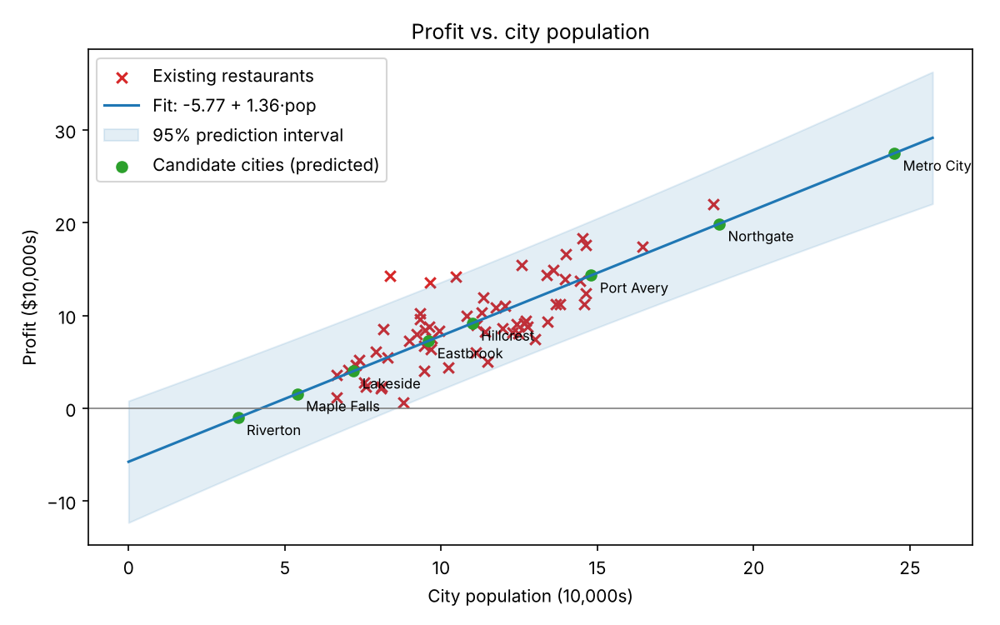
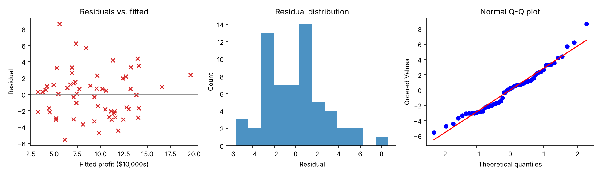

# Restaurant Expansion: Which City Next?
[](https://github.com/Clairechen163/restaurant-expansion/actions/workflows/python-app.yml)


[](https://restaurant-expansion.streamlit.app)


Suppose you are the CEO of a restaurant franchise deciding where to open a new outlet.
You have **profit and population** for cities that already have a restaurant, and only
**population** for candidate cities. This project fits a linear regression
(`profit ≈ θ₀ + θ₁ · population`) on existing outlets and uses it to **rank candidate cities
by predicted profit**.

> ⚠️ `data/` contains **synthetic sample data** so the project runs out of the box.
> Replace it with your real data (same column names) before drawing conclusions.

## Quick start

```bash
git clone https://github.com/Clairechen163/restaurant-expansion.git
cd restaurant-expansion
python -m venv .venv
.venv\Scripts\activate        # Windows PowerShell
# source .venv/bin/activate   # Mac/Linux
pip install -r requirements.txt
pip install -e .

python -m restaurant_expansion              # closed-form (normal equation)
python -m restaurant_expansion --method gd  # gradient descent + convergence plot
pytest                                      # run tests

pip install -r requirements-app.txt
python -m streamlit run app/streamlit_app.py   # interactive dashboard
```

Outputs go to `outputs/`: `ranked_candidates.csv`, `fit.png`, and `convergence.png` (gd only).

## Data format

| File | Columns |
|------|---------|
| `data/restaurants.csv` | `city, population, profit` |
| `data/candidate_cities.csv` | `city, population` |

Units: population in **10,000s**, profit in **$10,000s** (e.g. `population=7.2` = 72,000 people,
`profit=4.0` = $40,000). Use your own units consistently.

## Method

- **Model:** univariate linear regression, written from scratch in NumPy (`src/restaurant_expansion/model.py`).
- **Solvers:** normal equation and batch gradient descent (with feature standardization). Tests check they agree.
- **Decision rule:** rank candidates by predicted profit; flag `recommend = True` where predicted profit > 0.

## Project layout

```
data/        sample CSVs
scripts/     make_sample_data.py (regenerates the synthetic data)
src/restaurant_expansion/
  model.py     LinearRegression
  analysis.py  load, rank, plot
  __main__.py  CLI
tests/       pytest suite
```

## Evaluation

```bash
python -m restaurant_expansion --evaluate
```

- **Cross-validation:** 5-fold CV on out-of-fold predictions, compared with a baseline that always predicts the mean profit.
- **Prediction intervals:** 95% intervals for a single new city (the shaded band in the plot above).
- **Diagnostics:** residual vs. fitted, histogram and Q-Q plot, Shapiro-Wilk normality test, and a check for spread changing with city size.
- **Validation:** tests confirm the from-scratch model matches scikit-learn, and that the intervals cover about 95% of cases in simulation.

On the bundled **synthetic** data, cross-validated RMSE is about 2.9 (in $10,000s) against 4.6 for the baseline. The data is generated with noise of 2.8, so the error matches what the data allows. These numbers show the pipeline works. They are not findings about real restaurants.



## Source and attribution

The problem framing (predict restaurant profit from city population) follows a classic regression exercise from introductory machine-learning courses. The implementation, evaluation, tests, CI and dashboard are my own. The data is synthetic, generated by `scripts/make_sample_data.py`.

## Caveats and next steps

- Population alone is a weak predictor (sample R² ≈ 0.6). Real decisions should also consider
  rent, competition, income, foot traffic, and demographics.
- Predictions for populations outside the range seen in existing cities (extrapolation) are unreliable.
  Check candidate cities whose population is larger than any existing outlet.
## License

MIT
