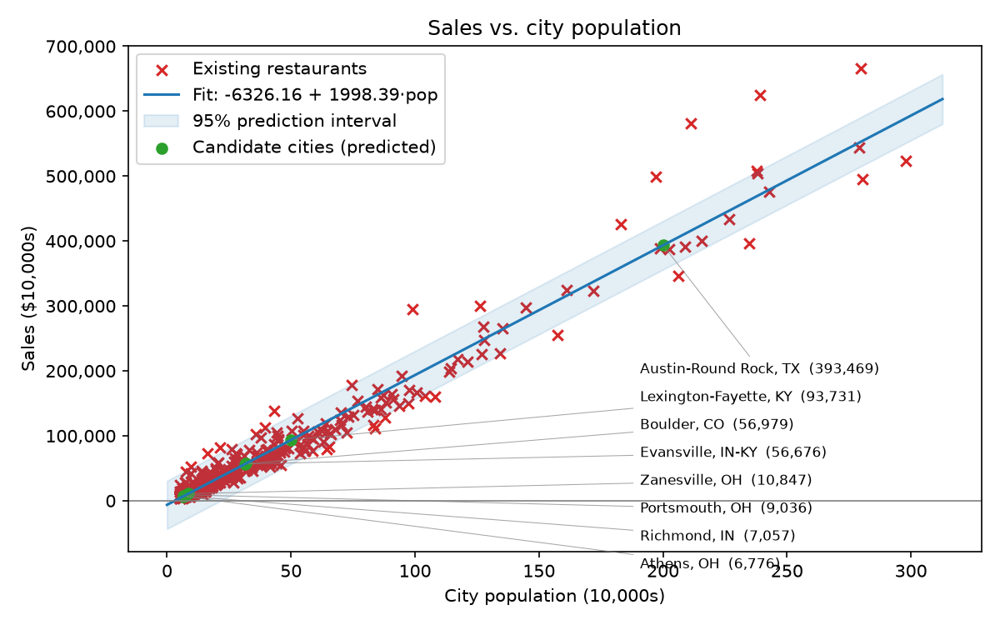
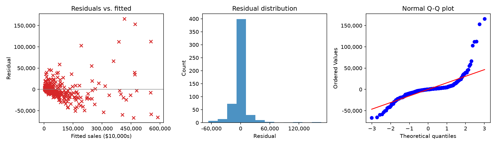

# Restaurant Expansion: Which City Next?
[](https://github.com/Clairechen163/restaurant-expansion/actions/workflows/python-app.yml)


[](https://restaurant-expansion.streamlit.app)


Suppose you are the CEO of a restaurant franchise deciding where to open a new outlet.
You have **profit and population** for cities that already have a restaurant, and only
**population** for candidate cities. This project fits a linear regression
(`profit ≈ θ₀ + θ₁ · population`) on existing outlets and uses it to **rank candidate cities
by predicted profit**.

> ⚠️ `data/` contains **synthetic sample data** so the project runs out of the box.
> Replace it with your real data (same column names) before drawing conclusions.

## Quick start

```bash
git clone https://github.com/Clairechen163/restaurant-expansion.git
cd restaurant-expansion
python -m venv .venv
.venv\Scripts\activate        # Windows PowerShell
# source .venv/bin/activate   # Mac/Linux
pip install -r requirements.txt
pip install -e .

python -m restaurant_expansion                 # closed-form (normal equation)
python -m restaurant_expansion --method gd     # gradient descent + convergence plot
python -m restaurant_expansion --evaluate      # cross-validation + residual diagnostics
pytest                                         # run tests

# Real data (free Census API key: https://api.census.gov/data/key_signup.html)
$env:CENSUS_API_KEY = "YOUR_KEY_HERE"      # Windows PowerShell
# export CENSUS_API_KEY=YOUR_KEY_HERE      # Mac/Linux
python -m restaurant_expansion.census --out data/real --naics 7225
python -m restaurant_expansion --restaurants data/real/restaurants.csv --candidates data/real/candidate_cities.csv --target sales --evaluate --out outputs/real

pip install -r requirements-app.txt
python -m streamlit run app/streamlit_app.py   # interactive dashboard
```

Outputs go to `outputs/`: `ranked_candidates.csv`, `fit.png`, `convergence.png` (gd only), and with `--evaluate`, `evaluation.txt` and `residuals.png`.

## Data format

| File | Columns |
|------|---------|
| `data/restaurants.csv` | `city, population, profit` |
| `data/candidate_cities.csv` | `city, population` |

Units: population in **10,000s**, profit in **$10,000s** (e.g. `population=7.2` = 72,000 people,
`profit=4.0` = $40,000). Use your own units consistently.

## Method

- **Model:** univariate linear regression, written from scratch in NumPy (`src/restaurant_expansion/model.py`).
- **Solvers:** normal equation and batch gradient descent (with feature standardization). Tests check they agree.
- **Decision rule:** rank candidates by predicted profit; flag `recommend = True` where predicted profit > 0.

## Project layout

```
   app/         streamlit_app.py (interactive dashboard)
   data/        sample CSVs
   docs/        fit.png, residuals.png, real_fit.png, real_residuals.png
   scripts/     make_sample_data.py (regenerates the synthetic data)
   src/restaurant_expansion/
     model.py       LinearRegression
     evaluation.py  cross-validation, prediction intervals, diagnostics
     census.py      download and prepare real Census data
     analysis.py    load, rank, plot
     __main__.py    CLI
   tests/       pytest suite
```

## Evaluation

```bash
python -m restaurant_expansion --evaluate
```

- **Cross-validation:** 5-fold CV on out-of-fold predictions, compared with a baseline that always predicts the mean profit.
- **Prediction intervals:** 95% intervals for a single new city (the shaded band in the plot above).
- **Diagnostics:** residual vs. fitted, histogram and Q-Q plot, Shapiro-Wilk normality test, and a check for spread changing with city size.
- **Validation:** tests confirm the from-scratch model matches scikit-learn, and that the intervals cover about 95% of cases in simulation.

On the bundled **synthetic** data, cross-validated RMSE is about 2.9 (in $10,000s) against 4.6 for the baseline. The data is generated with noise of 2.8, so the error matches what the data allows. These numbers show the pipeline works. They are not findings about real restaurants.


## Results on real data (U.S. Census)

Data: 2017 Economic Census sales for **NAICS 7225 (Restaurants and Other Eating Places)**, joined with 2017 ACS 5-year population by metropolitan/micropolitan statistical area. 835 of 933 areas had published sales; 549 had 50,000 to 3,000,000 residents; 541 were used for fitting and 8 were held out. The target is **sales (revenue)**, not profit, because the Census does not publish profit by metro area. Prepared with `python -m restaurant_expansion.census`.

Fitted line: sales ≈ −$63M + $20M per 10,000 residents (about **$2,000 of restaurant sales per resident per year**).

| Metric (5-fold cross-validation) | Model | Predict-the-mean baseline |
|---|---|---|
| RMSE | $190.7M | $952.4M |
| MAE | $94.6M | n/a |
| Out-of-fold R² | 0.96 | n/a |

- **Error cut by 80%** versus the baseline.
- **R² flatters the model.** Sales scale almost proportionally with population, so R² is dominated by the gap between big and small metros. On the 8 held-out metros the typical error is **22.6%** (3 of 8 within 15%, 6 of 8 within 30%), and 7 of 8 were under-predicted (median −23.5%). With only 8 metros this is indicative, not conclusive.
- **Population alone is not enough.** In these 8 metros, sales per resident ranges from about $1,300 (Portsmouth, OH) to about $2,900 (Boulder, CO), while the model assumes a single slope.
- **Assumption check fails, and I report it.** Residual spread grows with metro size (Spearman ρ = +0.60, p < 0.001) and residuals are not normal (Shapiro-Wilk p < 0.001). The constant-variance 95% prediction intervals are therefore unreliable here: too narrow for large metros, too wide for small ones.
- **Next step:** fit log(sales) on log(population), which targets percentage error and makes the spread roughly constant.




*Source: U.S. Census Bureau, 2017 Economic Census (`ecnbasic` API) and 2017 American Community Survey 5-Year Estimates (Table B01003), accessed 14 October 2026. This product uses the Census Bureau Data API but is not endorsed or certified by the Census Bureau. The raw data is not stored in this repository; the script above downloads it.*

## Source and attribution

The problem framing (predict restaurant profit from city population) follows a classic regression exercise from introductory machine-learning courses. The implementation, evaluation, tests, CI and dashboard are my own. The bundled sample data in `data/` is synthetic (generated by `scripts/make_sample_data.py`); the real-data results above use U.S. Census Bureau data, downloaded by `python -m restaurant_expansion.census`.

## Caveats and next steps

- Population alone is a weak predictor on the synthetic sample (R² ≈ 0.6); on real Census data it explains most of the total-sales variation (R² 0.96) but typical per-metro error is still about 23% (see above). Real decisions should also consider rent, competition, income, foot traffic and demographics.
- Predictions for populations outside the range seen in existing cities (extrapolation) are unreliable.
  Check candidate cities whose population is larger than any existing outlet.
## License

MIT
